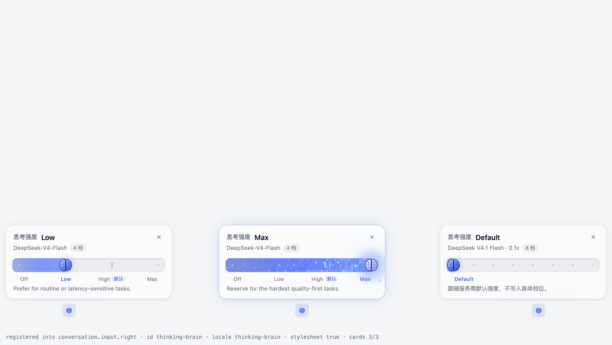
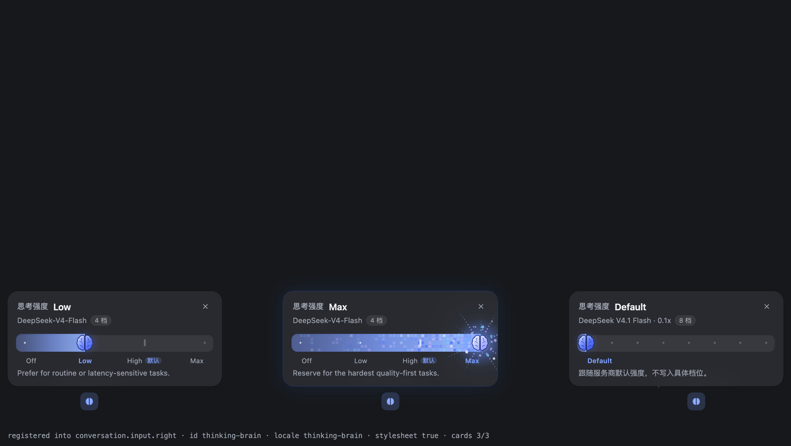

# dsh-plugin-thinking-brain

> Language: [中文](./README.md) ｜ **English**

A DeepSeek Harness (`dsh`) Web client plugin: a **brain button** beside the composer's model selector. Clicking it opens an anchored card with a **segmented thinking-effort slider** for the current model, kept in **two-way sync** with the shipped model/effort menu.

---

## Why

The shipped control keeps `reasoningEffort` one menu level down: open the model menu, then pick a level. You only see the current value — not which levels exist or where you are on the range.

This plugin spreads that choice into a visible segmented rail where your hand already is, and it owns **no state of its own**: stops, the model default, failures and the caption all come from the host model directory.

## Features

- **Segments follow the model.** Stops are the selected model's own `reasoning.efforts` from the Host model catalog (least → greatest).
  - Models that declare a default effort (e.g. official DeepSeek: Off / Low / High / Max) show only real levels; the default carries a taller stop marker and a `Default` tag on its label.
  - Models whose adapter declares no `defaultEffort` (pi-ai / OpenCode Go and friends) also show the **`Default`** choice the model menu offers — the one that sends no explicit effort, which is the `Default` in the composer caption.
  - Switching models re-segments the slider; a model without a reasoning control shows a short note instead of a fake rail.
- **Two controls, one state.** The seat subscribes to the session's shared `ModelDirectory` and submits through the same `select()` the model menu uses:
  - a pick in the model menu moves this slider and its header;
  - a change here updates the composer caption;
  - a Host refusal shows the error inside the card instead of silently snapping back.
  - **The shipped selector is untouched.**
- **Animated, but calm.** The fill is built from the product's DeepSeek blue; it grows a seeded pixel-mosaic shimmer as the level rises and blooms into orbiting particles plus a dotted starburst at the top level, while the brain thumb re-tints along the same ramp. The canvas stops repainting once nothing moves, and `prefers-reduced-motion` removes the motion entirely.
- **Light and dark.** The card uses the same surface material as the shipped menus (`--dsw-menu-surface-fill`, backdrop blur, `--dsw-elevation-prominent`), and its canvas palette follows the document's `data-ds-dark-theme` attribute.
- **Keyboard.** Arrow keys move one level (repeats stage locally and commit once), `Home`/`End` jump to the ends, `Escape` closes and returns focus to the brain button. Pressing outside closes without stealing focus from what you clicked.

## Where it appears

`conversation.input.right` — the composer tool row's trailing group, rendered as `[right entries][model seat][send]`, so the button sits exactly where the model caption begins. The seat is a single 28 px button.

## Install

- **From Git (recommended):** **Plugins → Add plugin** with
  `github:lionwill/dsh-plugin-thinking-brain`
- **From npm** (if published): `dsh-plugin-thinking-brain`
- **Local development:** install this directory with `plugin_manager` `install_bundle` (it links the checkout), then toggle the plugin row to hot-reload after edits.

Disable the plugin row to remove the button entirely — nothing else changes.

## Compatibility

- Running version: DSH `0.2.2-rc.5` (`package.json` → `engines.dsh: ^0.2.2-rc.5`).
- Requires the client model-selection plugin (`ctx.modelDirectories`); addressed subagent sessions cannot change models, so the seat stays inert there.
- No build step: `lib/client.js` is the artifact, loaded through DSH's Client module system.

## How it works

1. `apply()` injects `['slots', 'modelDirectories']` and registers a seat in `conversation.input.right`.
2. The registration's `inject(sessionId)` resolves `ctx.modelDirectories.directoryFor(sessionId)`, hands `ModelDirectory.store` to the component as a `hooks` source, and passes `directory.select()` through.
3. The card renders into `document.body` (the composer clips its own overlay), anchored above the button and following composer height changes.
4. The rail is Canvas: gradient fill → pixel mosaic → particles/starburst, all driven by one normalized effort `t`; the brain thumb interpolates its gradient stops from the same `t`.
5. Committing a real level sends `{ provider, model, reasoningEffort }`; the `Default` stop **omits** `reasoningEffort`.

## Limitations

- It only changes the current session's reasoning effort; it cannot add levels a provider did not advertise.
- It does not edit a global default itself — the Host persists the selection exactly like the model menu.
- Card visuals were verified in light and dark, but the authenticated page cannot be screenshotted in the build environment; refresh once if your client has not picked up the new Client bundle.

## Files

| File | Purpose |
| --- | --- |
| `lib/index.js` | Inert Host half (keeps the package a normal plugin row) |
| `lib/client.js` | Browser half: seat, anchored card, Canvas engine |
| `cordis.patch.yml` | Bundle patch inserting the `thinking-brain` row |
| `locale/*.json` | Plugin Manager title and description |
| `icon.svg` | Brain mark (36×36) |
| `docs/preview-*.png` | Light/dark previews used above |

## License

MIT — see [LICENSE](./LICENSE). The visual language follows the user-supplied "DSH thinking effort slider" reference page, including the brain silhouette and the motion vocabulary.
