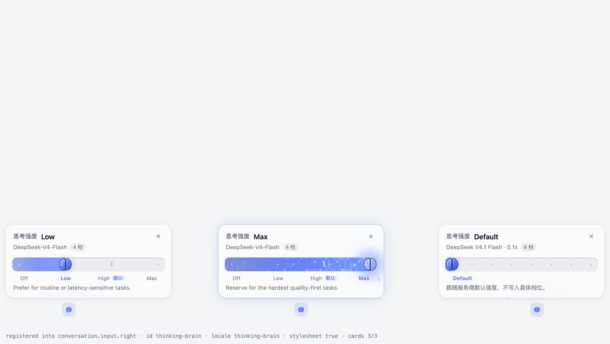
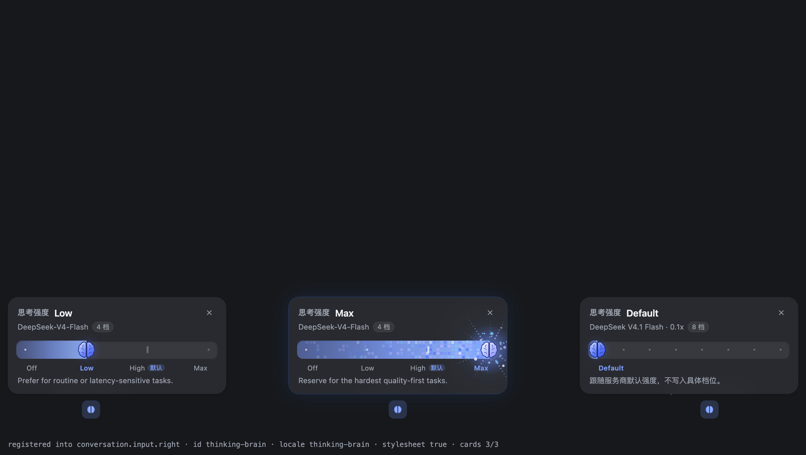

# dsh-plugin-thinking-brain

> 语言 / Language：**中文（GitHub 默认展示）** ｜ [English](./README.en.md)

DeepSeek Harness（`dsh`）Web 客户端插件：在输入框右下角、模型选择器左侧加一个**脑子图标**，点开后是一张**按模型分段的思考强度滑块**卡片，和自带的模型/思考强度选择器**双向同步**。




---

## 它解决什么问题

DSH 把「思考强度」（`reasoningEffort`）藏在模型菜单的第二层：先点模型名，再点思考档位。想快速调一档要两步，而且只看得到当前值，看不到「还有哪些档、当前处在什么位置」。

这个插件把那层选择摊开成一条**可视化的分段滑轨**，放在你伸手就能点到的地方；档位本身、默认档、失败提示全部复用宿主已有的模型目录，不维护第二份状态。

## 功能

- **分段跟着模型走。** 停点来自 Host 模型目录里该模型的 `reasoning.efforts`（从低到高）。
  - 声明了默认档的模型（如官方 DeepSeek 的 Off / Low / High / Max）：只显示真实档位，默认档用加高停点 + 标签上的「默认」小标记标出。
  - 不声明默认档的模型（pi-ai / OpenCode Go 这一类）：额外显示模型菜单里那个 **`Default`** 选项——也就是你截图里 caption 末尾的 `Default`，选它等于**不发送具体档位**，交给服务商决定。
  - 模型切换后滑块立刻重新分段；完全不带思考控制的模型显示一句说明，而不是给你一条假滑轨。
- **两个控件，一份状态。** 滑块订阅会话共享的 `ModelDirectory`，提交走和模型菜单**同一个** `select()`。所以：
  - 在模型菜单里改档位 → 滑块和卡片标题立刻跟着走；
  - 在滑块上改 → 输入框 caption 跟着变；
  - Host 拒绝（例如会话被占用）→ 卡片里直接显示错误，不会悄悄弹回去。
  - **原来那个选择器一个字没动。**
- **视觉动效。** 轨道填充取自产品 DeepSeek 蓝；档位升高时填充长出像素马赛克微光，顶级再展开环绕粒子 + 点状星芒，大脑滑块沿同一色带换色。静止后画布停止重绘，`prefers-reduced-motion` 下完全关闭动效。
- **白天 / 黑夜。** 卡片用和原生菜单同款表面材质（`--dsw-menu-surface-fill` + backdrop 模糊 + `--dsw-elevation-prominent`），画布调色板跟随 `data-ds-dark-theme`，不复制主题设置。
- **键盘。** `←` `→` 逐档（按住连发只在停止后提交一次）、`Home` / `End` 到两端、`Esc` 关闭并把焦点还给脑子按钮；点击外部关闭时不抢走你刚点的那里的焦点。

## 在哪里

注册进 `conversation.input.right`——输入框工具行的尾部组，渲染顺序是 `[右侧扩展项][模型选择器][发送]`，所以按钮正好贴在模型 caption 左边：

```
┌──────────────────────────────────────────────────────────┐
│  … 输入区 …                                               │
│  [+] [权限] [计划]      …        [🧠] DeepSeek … · Default  [发送] │
└──────────────────────────────────────────────────────────┘
```

## 安装

- **从 Git 安装（推荐）**：DSH 的 **Plugins → Add plugin** 里填
  `github:lionwill/dsh-plugin-thinking-brain`
- **从 npm 安装**（如已发布）：填包名 `dsh-plugin-thinking-brain`
- **本地开发**：把本目录用 `plugin_manager` 的 `install_bundle` 装成本地链接即可，改完文件在 Plugins 里重新启用一行就会热更新。

安装后在 **Plugins** 里能看到 `dsh-plugin-thinking-brain` 一行；不需要时关掉它即完全还原输入框。

## 兼容性

- 运行版本：DSH `0.2.2-rc.5`（`package.json` 的 `engines.dsh: ^0.2.2-rc.5`）。
- 需要客户端的模型选择插件在位（`ctx.modelDirectories`）。子代理会话不支持改模型，此时按钮保持惰性。
- 无构建步骤：`lib/client.js` 就是产物，浏览器端通过 DSH 的 Client 模块系统加载。

## 工作原理（实现要点）

1. `apply()` 里通过 `ctx.inject(['slots', 'modelDirectories'], …)` 拿到会话的共享模型目录，注册一个 `conversation.input.right` 席位。
2. 注册的 `inject(sessionId)` 里调用 `ctx.modelDirectories.directoryFor(sessionId)`，把 `ModelDirectory.store` 作为 `hooks` 交给组件，并透传 `directory.select()`。
3. 卡片由 React 渲染到 `document.body`（输入框会裁切自己的浮层），用按钮的 `getBoundingClientRect()` 锚定在输入框上方，并轮询跟随输入框高度变化。
4. 滑轨是 Canvas：填充渐变 → 像素马赛克 → 粒子/星芒，全部按归一化档位 `t` 计算；大脑 thumb 的渐变 stop 由同一 `t` 插值。
5. 提交时，普通档位发送 `{provider, model, reasoningEffort}`；`Default` 停点**省略** `reasoningEffort` 字段。

## 限制

- 只改当前会话的思考强度；不新增服务商没有的档位。
- 不自己改全局默认值——交给 Host 像模型菜单一样处理。
- 卡片视觉在浅/深色下都验证过，但无法在本环境对真实登录页面截图；如果你的 DSH 客户端还没收到新的 Client bundle，刷新一次页面即可。

## 文件

| 文件 | 作用 |
| --- | --- |
| `lib/index.js` | Host 半边（空实现，仅让包成为正常的插件行） |
| `lib/client.js` | 浏览器半边：脑子按钮、锚定卡片、Canvas 引擎 |
| `cordis.patch.yml` | Bundle patch，插入 `thinking-brain` 一行 |
| `locale/*.json` | Plugins 页面里的标题与描述 |
| `icon.svg` | 脑子图标（36×36） |
| `docs/preview-*.png` | README 里的浅色/深色预览 |

## 许可

MIT，见 [LICENSE](./LICENSE)。视觉样式参考了用户提供的「DSH 思考强度滑块」参考页，脑形轮廓与动效语言沿用该参考。
